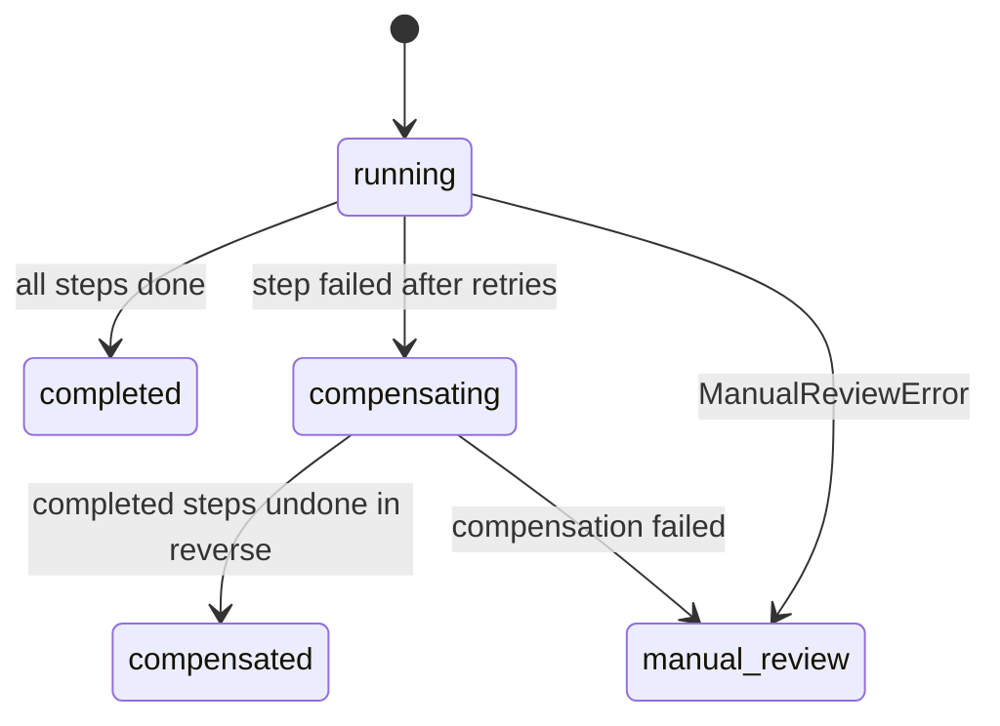

A cross-border payment touches multiple chains and multiple partners. None of them participate in a distributed transaction, so there is no single commit that either completes everything or reverts everything. Corridor handles this with a **saga**: a sequence of legs, each recorded durably in Postgres, each with a compensating action that can undo it in reverse order if a later step fails. You get automatic recovery, no double payments, and a clear queue for the rare cases that need human review.

## The leg contract

Every step in a route — reserving funds in the ledger, bridging across Across, funding a partner payout — is implemented as a `Leg`:

```ts
interface Leg<D> {
  kind: LegKind;
  forward(ctx: LegContext<D>): Promise<LegOutcome>;
  compensate?(ctx: LegContext<D>, output: Json): Promise<LegOutcome>; // omit if nothing to undo
  maxAttempts?: number;
  backoffMs?: number;
}

interface LegOutcome {
  output: Json;           // stored on the step; passed to later steps and to compensate()
  bookings?: EntryInput[]; // posted to the ledger after the leg succeeds
}
```

Every call receives an `idempotencyKey` of `${sagaId}:${stepIndex}`. Bookings without an external reference are keyed on it, so re-running a step after a crash never double-books. Legs that move money first look for the movement by its Corridor Reference, so a retry after a crash between "sent" and "recorded" finds the original transfer rather than sending again.

## Saga state

The saga and every step it has taken are persisted in Postgres:

```sql
sagas       (id, kind, reference, status, input, lease_owner, lease_until)
saga_steps  (saga_id, idx, kind, status, attempts, output, error)
saga_events (saga_id, idx, event, detail, at)   -- the audit trail shown in the console
```

A saga moves through a defined set of statuses:



## How failures are handled

<AccordionGroup>
  <Accordion title="Retryable errors" icon="rotate-ccw">
    The step is retried up to `maxAttempts` with exponential backoff. Network errors and RPC timeouts land here. Retry timeouts are configured per leg kind — a bridge fill watcher has a longer window than a ledger reservation.
  </Accordion>
  <Accordion title="Non-retryable errors" icon="circle-x">
    The step fails immediately (for validations that a retry cannot change), and the saga moves directly to compensation.
  </Accordion>
  <Accordion title="Compensation in reverse order" icon="undo-2">
    When a step exhausts its retries, all previously completed steps are undone from last to first — each through its own `compensate()` function with its own ledger bookings. Order matters: unwinding steps out of order can produce a balanced ledger with a misleading audit trail. A forced partner failure on testnet issues an on-chain refund via Tempo and reverses every booking.
  </Accordion>
  <Accordion title="Manual review" icon="hand">
    When money has already left Corridor's control — for example, a partner rejects a payout it was already funded for — no automatic compensation runs. Reversing earlier legs would be wrong until the partner's refund is confirmed. The saga stops at `manual_review`, and your exceptions queue is updated. A human closes it once the partner's refund arrives.
  </Accordion>
</AccordionGroup>

## Exactly-once funding

A payout step records its partner order and the funding transaction durably in `partner_order_links` before acknowledging success. This means:

- If a worker crashes **after opening a partner order but before recording it**, the retry re-opens the same order (idempotency key) rather than creating a second one.
- If a worker crashes **after funding but before marking the step complete**, the retry finds the funding reference and does not send again.
- A partner failure **after** funding stops the saga at `manual_review`. The money is at the partner until its refund is confirmed, so earlier legs are not automatically reversed.

## Lease-guarded execution

Only one worker drives a saga at a time. `run()` takes a database lease (`lease_owner`, `lease_until`, default 120 seconds) with a conditional update. A second worker that tries to claim an active saga gets the current status back without doing any work. If the first worker dies, its lease expires and any worker can resume from the last durable step.

<Warning>
A worker whose lease expired mid-leg could still finish its call. Legs are idempotent through the Corridor Reference memo lookup, so the chain is never double-spent. Fencing tokens on bookings are on the roadmap to make this airtight.
</Warning>

## What this means for you

<CardGroup cols={3}>
  <Card title="No double payments" icon="fingerprint">
    Idempotency keys and the unique booking constraint mean every leg executes exactly once, regardless of retries or worker restarts.
  </Card>
  <Card title="Automatic recovery" icon="rotate-ccw">
    Transient failures — network blips, RPC timeouts, partner rate limits — are retried automatically with backoff. Your treasury team sees a completed settlement, not an error.
  </Card>
  <Card title="Clear exception queue" icon="inbox">
    The small number of payouts that reach `manual_review` are surfaced immediately in the Treasury Console with the full step history, error detail, and explorer links for every on-chain movement.
  </Card>
</CardGroup>

## Fault injection

`SagaInput.faults.failAt` makes a chosen leg kind fail on demand, which is how Corridor's live demo proves that compensation actually runs on-chain. The Treasury Console's **"Payout with partner failure"** button uses it: you can watch Tempo issue a real on-chain refund and every ledger booking reverse in order.
