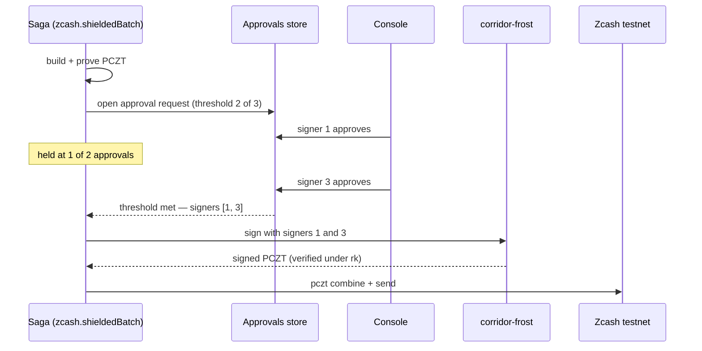

A shielded vault controlled by one key is one stolen laptop away from a complete loss. Corridor's FROST vaults hold the spend-authorizing key `ak` only as shares — the full spending key never exists anywhere. Any two of three designated signers can authorize a batch payout; one alone is refused, by the code and by the cryptography.

## Signers

| Signer | Held by |
|---|---|
| 1 | Customer approver |
| 2 | Customer finance lead |
| 3 | Corridor |

Any two can authorize a payout batch. Neither the customer nor Corridor can move funds unilaterally.

## The ciphersuite

`corridor-frost` is a Rust service (`services/zcash-frost`) built on the `reddsa` FROST(RedPallas) ciphersuite with `frost-rerandomized`. RedPallas is the signature scheme used by Ironwood (and Orchard) actions. The rerandomized variant is necessary because Ironwood randomizes each spend's validating key per action.

## Keygen

`corridor-frost keygen` runs a trusted-dealer key generation and writes three share files plus a `public.json` to the output directory.

```bash
corridor-frost keygen \
  --threshold 2 \
  --signers 3 \
  --network test \
  --out .keys/frost-treasury
```

The group verifying key must have a positive-y encoding to be a valid Ironwood `ak`. Keygen retries until it produces one. The `public.json` contains:

```json
{
  "threshold": 2,
  "signers": 3,
  "network": "test",
  "group_key": "...",
  "ufvk": "uviewtest1...",
  "address": "utest1..."
}
```

The unified full viewing key (`ufvk`) and vault address are derived from `ak ‖ nk ‖ rivk` using `FullViewingKey::from_bytes` — a public librustzcash API, with no crate fork.

In TypeScript, keygen and signing are wrapped by `FrostSigner`:

```ts
import { FrostSigner } from "@corridor/chain-zcash";

const signer = FrostSigner.keygen(frostBin, ".keys/frost-treasury", {
  threshold: 2,
  signers: 3,
  network: "test",
});

const vault = signer.vault();
// vault.ufvk   — import into zcash-devtool for building and proving PCZTs
// vault.address — the unified Zcash address; fund this to fill the vault
```

## Signing a batch

The PCZT is built and proven by `zcash-devtool` using the vault's view-only wallet (imported from the UFVK). `corridor-frost sign` then handles the threshold signature:

```bash
corridor-frost sign \
  --pczt proven.pczt \
  --keys .keys/frost-treasury \
  --signers 1,3 \
  --out signed.pczt
```

For every unsigned Ironwood action in the PCZT, `corridor-frost sign`:

1. Reads the action's randomizer `alpha`.
2. Checks `rk == ak + [alpha]G` — confirming this is a spend by this vault, not any other.
3. Runs FROST round 1 and round 2, **rerandomized by alpha**, over the specified signers.
4. Aggregates the partial signatures.
5. Verifies the RedPallas signature against `rk`.
6. Applies it with `Signer::apply_ironwood_signature`.

A signer set below the threshold is refused with an error before any cryptographic work.

```ts
const result = signer.sign("proven.pczt", [1, 3], "signed.pczt");
// result.signed: 2     — number of actions signed
// result.signers: [1, 3]
// result.threshold: 2
// result.sighash: "..."
```

## Why rerandomization preserves privacy

Ironwood randomizes the spend validating key per action (`rk = ak + [alpha]G`) so different spends from the same vault cannot be linked on-chain. A threshold signature must be produced under `rk`, not `ak`. FROST rerandomized signing does exactly this: it runs the signing protocol under the rerandomized key, so threshold control costs no additional privacy.

## Approval workflow

The saga opens an approval request and waits at the saga engine level. Signers approve through console buttons or the API. Only after the threshold is met does the engine call `corridor-frost sign` with exactly the approving signers.



## Test coverage

| Test | What it proves |
|---|---|
| `two_of_three_produces_a_valid_rerandomized_spend_auth_signature` | A 2-of-3 rerandomized signature verifies under `rk` |
| `any_two_signers_work_but_one_does_not` | Every pair of signers succeeds; any single signer fails |
| `keygen_writes_a_valid_ironwood_viewing_key_and_address` | The group key yields a valid Ironwood UFVK and address |

## Scope: demo vs production

|  | Demo / hackathon | Production |
|---|---|---|
| Key generation | Trusted dealer | Distributed key generation (DKG) |
| Rounds | Both rounds in one process over separate share files | Each signer on their own device, relaying through `frostd` |
| PCZT interface | Unchanged | Unchanged |
| Cryptography | Unchanged | Unchanged |

The PCZT interface and all cryptographic operations are identical between the two configurations.

## Testnet evidence

Signer 2 alone was refused. Signers 1 and 3 co-signed a batch paying three recipients:

[`878b44b8…`](https://testnet.zcashexplorer.app/transactions/878b44b81d518e5d5333f9d21e5f4d6017c6ce16afbdf484eb7a038b7edd355c)

A full saga run — held at one approval in the console until signer 3 approved — then broadcast:

[`ba4e845b…`](https://testnet.zcashexplorer.app/transactions/ba4e845b81b7d6faf350fd01cf967d9d35d717d5bc3eb455eb48ee945b3c38c7)
