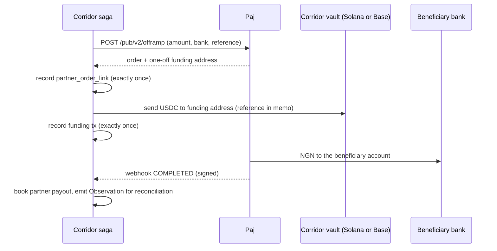

[Paj](https://paj.cash) converts between USDC and Nigerian naira through a business API. The `PajPartner` class in `@corridor/partners` is built against Paj's [Public API v2 OpenAPI specification](https://docs.paj.cash/api-reference/openapi.json) and implements the full [RampPartner interface](/integrations/partner-interface), so it plugs into the routing engine and reconciliation without any special handling.

## Why Paj

<CardGroup cols={2}>
  <Card title="Naira both ways" icon="arrow-right-arrow-left">
    Offramp (USDC → NGN to a beneficiary bank account) and onramp (NGN via virtual account → USDC) in one API.
  </Card>
  <Card title="Solana and Base" icon="link">
    Settles on both Solana and Base. A mainnet NGN payout requires only one Across hop: Tempo → Base → Paj.
  </Card>
  <Card title="Signed webhooks" icon="shield-check">
    HMAC-SHA256 over a timestamp and raw body — the same scheme Corridor uses for its own webhooks — so no adapter code is needed for verification.
  </Card>
  <Card title="Zcash on the roadmap" icon="clock">
    `ZCASH` already appears in Paj's chain enum (not yet open), a future path for shielded payouts directly to naira.
  </Card>
</CardGroup>

## API mapping

| Corridor method | Paj API v2 endpoint | Notes |
|---|---|---|
| `rates(currency)` | `GET /pub/v2/rate?currency=…` | On-ramp and off-ramp rates per USD |
| `openPayout(req)` | `POST /pub/v2/offramp` | Returns a **one-off funding address**, valid for 2 hours |
| `openCollection(req)` | `POST /pub/v2/onramp` | Returns a **one-off virtual bank account** for the payer |
| `getOrder(id)` | `GET /pub/v2/transaction/{id}` | Polled as a fallback when webhooks are delayed |
| `verifyWebhook` | `X-PAJ-Timestamp` + `X-PAJ-Signature` | `v1=<hmac-hex>`, 5-minute window |
| `parseWebhook` | Webhook body | Normalised to `PartnerOrder` |

All requests authenticate with an `x-api-key` header. The Corridor Reference rides in Paj's `description` (offramp) and `userExternalId` (onramp) fields and is echoed back verbatim on every webhook delivery.

## Opening a payout (offramp)

```ts
import { PajPartner } from "@corridor/partners";

const paj = new PajPartner({ apiKey: process.env.PAJ_API_KEY! });

const order = await paj.openPayout({
  currency: "NGN",
  chain: "SOLANA",
  usdcAmount: 10_000_000n,          // 10 USDC
  beneficiary: {
    bankCode: "044",                 // Access Bank
    accountNumber: "0123456789",
  },
  reference: ref,                    // 32-byte Corridor Reference as 0x-prefixed hex
  webhookUrl: "https://api.corridor.finance/webhooks/paj",
});

// order.fundingAddress: one-off Solana address — send USDC here within 2 hours
// order.status: "open"
```

## Opening a collection (onramp)

```ts
const order = await paj.openCollection({
  currency: "NGN",
  chain: "SOLANA",
  fiatAmount: 1_560_000_00n,        // ₦1,560,000 in minor units (kobo)
  recipient: corridorIngressWallet,  // USDC delivered here when the payer transfers
  reference: ref,
  webhookUrl: "https://api.corridor.finance/webhooks/paj",
});

// order.virtualAccount: { bank, accountNumber, accountName }
// Payer transfers ₦1,560,000 to this account; Paj delivers USDC to corridorIngressWallet
```

## Status normalisation

| Paj status | Corridor status |
|---|---|
| `INIT`, `PENDDING`, `PENDING` | `open` |
| `PROCESSING` | `processing` |
| `COMPLETED` | `completed` |
| `ERROR` | `failed` |

<Note>
  `PENDDING` is Paj's spelling as it appears in their API reference examples. The adapter maps both spellings to `open`.
</Note>

## Payout lifecycle



## Webhook verification

Paj signs each delivery with HMAC-SHA256 over `{timestamp}.{rawBody}`, prefixed `v1=`. Corridor verifies in constant time within a 5-minute window:

```ts
// verifyWebhookSignature is shared with Corridor's own outbound webhooks
paj.verifyWebhook(rawBody, req.headers);
// Returns true only if the signature is valid and the timestamp is within 5 minutes
```

The signature header may carry multiple schemes during a key rotation (`v1=…, v2=…`). Verification accepts any matching `v1=` entry.

## Exactly-once funding

The saga leg records the partner order link and the funding transaction durably in the step table before broadcasting anything. Retries and process crashes reuse the existing records rather than creating a second order or sending a second transfer.

<Warning>
  If the partner returns an error **after** USDC has been sent to the funding address, the saga stops at `manual_review` rather than attempting a refund. The funds are at Paj; Corridor does not unwind its own books until Paj's refund is confirmed.
</Warning>

## Markets covered

Paj pays out to NGN, GHS, KES, TZS, and ZAR bank accounts today. The Corridor `PajPartner` class reflects this:

```ts
readonly payoutCurrencies = ["NGN", "GHS", "KES", "TZS", "ZAR"];
readonly collectionCurrencies = ["NGN"];
readonly chains = ["SOLANA", "BASE"];
```

## Mock partner for testnet

A Paj-shaped mock (`MockPartner` in `@corridor/partners`) implements the same lifecycle, signs its webhooks with the same HMAC scheme, and delivers them over real HTTP to Corridor's webhook server. When the devnet vault holds USDC the mock observes a real Solana devnet funding transfer.

<Note>
  Going live requires a Paj business API key. No code changes are needed: the `PartnerRegistry` routes to `PajPartner` instead of the mock once the key is present in the environment.
</Note>
